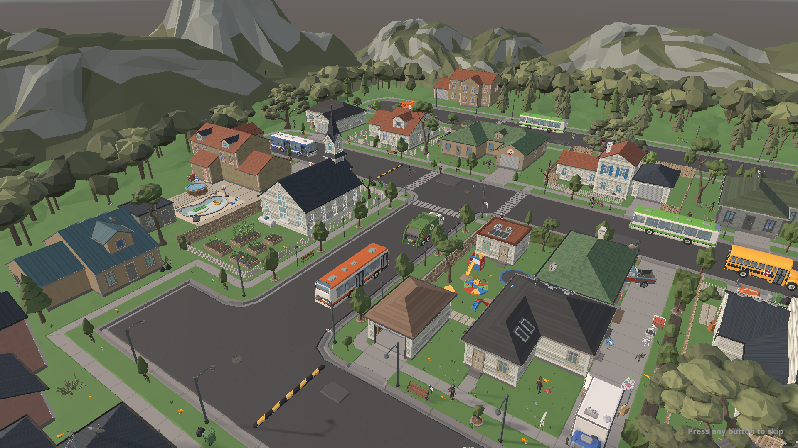

# Slombiez: devlog

A living zombie town where every human and every zombie was a *person*. Watch their stories unfold, read their thoughts, follow them, or (soon) try to survive among them.

Built in Unity 6 (URP) with Synty art, for PC and Steam Deck. Single-player.

## Where it's at
> **Just woke up?** [Overnight: v0.10 → v0.16 in one page](posts/2026-11-01-overnight-summary.md)

**Latest: v0.16.0-alpha** · [latest post](posts/2026-11-01-v0.16-look-before-you-go.md) · [all posts](posts/) · [changelog](CHANGELOG.md)

- **A real town:** 75 people (residents and visitors), each with a name, job, family, personality, fears and a past. They live their day: sleep, work shifts, errands, visits, strolls.
- **The outbreak starts small:** the night's dead rise at home among their families, one walks the street, and four people are bitten who don't know it yet. Every zombie that will ever walk here is one of the townspeople.
- **Minds that know only what they've seen:** before someone sees the dead, they think about work and the flu going round. The curious go to look at gunshots, and that is how it spreads.
- **Their story and their people:** a defining moment from their past, today's moments, and arcs in the world to everyone they love (alive, risen or dead).
- **Inspect anyone:** what they're doing and why, in their own words; fear, alarm and health; their thoughts; their people. You see what they don't: *"Infected. They don't know yet."*
- **The dead remember:** they drift back to their homes, workplaces and loved ones. Hordes only form with a reason, and loners walk alone.
- **Through their eyes:** ride any person's or zombie's head. Fear closes in on the living; the dead see sound.
- **Director camera:** cuts to the most dramatic moment and captions it.
- **Death replay:** rewind anyone's last minute and relive it through their eyes.
- **Traffic until it falls apart:** the town's own cars, bus and garbage truck drive, then crash, get abandoned, and flee town.
- **A town that decays:** blood, glass, rubble and trash accumulate where things happened.
- **Whispers.** Put a thought in anyone's head (D-pad ▼): find their daughter, go home, hide, doubt a friend. Or type your own words. Even the dead can be stirred toward home or someone they loved. They react as themselves, and a thought that takes hold changes what they do.
- **Survival: become anyone.** Take over any living person (or Start > Become someone): needs, loot, barricades, weapons, sneaking. When they die, carry on as someone who loved them.
- **Save and load** the whole town exactly, mid-story.
- **Pause menu** built for the Deck: live graphics switch, New town (new people, new story), controls, quit.
- **Weather:** misty mornings, foggy dusks and rain that hide you and drown your footsteps.
- **Day and night,** street lamps, roof cutaway that reveals who's sheltering inside to look inside, an intro cinematic that finds a real patient zero, and a live "what's happening" feed.

## Builds
Each update comes in two flavours:
- **Steam Deck:** a single-file **AppImage** (plus a folder build), tuned for the Deck (Vulkan, 1280×800, about 60 fps target with headroom).
- **PC Ultra:** long-range 4K shadow maps, ambient occlusion, MSAA, cinematic post-processing.

Playable builds are **private alpha** downloads ([private releases](https://github.com/ali3b/Slombiez/releases), invite only), because they contain licensed Synty art, which is only distributed with the final game. This repo is the public story of the build: screenshots, what changed, and what's next.

## Roadmap
| Phase | | |
|---|---|---|
| 0 Foundation | done | sim core, asset policy, Deck pipeline |
| 1 Zombie ant farm | done | baked town, NavMesh, hordes, noise, day/night |
| 2 Simulated humans + Observer | **in progress** | psyches, outbreak, inspector, thoughts, intro, voices |
| 2.5 Spectacle | done | director cam, through-their-eyes POV, death replay |
| 3 Survival mode | **in progress** | become anyone: needs, loot, barricades, weapons, carry on as a loved one |
| 4 Town/City | **started** | ~~traffic until it falls apart~~, ~~decay~~, districts |
| 5 Mall · 6 Office | | different ways to play |
| 7 Polish & release | | |

---
*Devlog maintained by Claude (Anthropic's AI) working on the project, with direction from the game's creator.*
