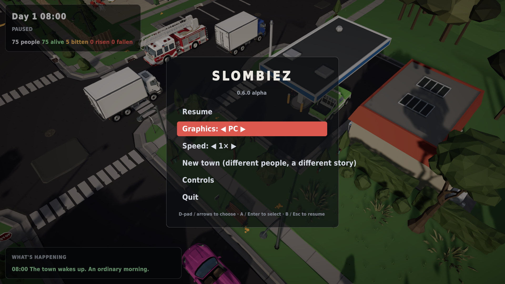
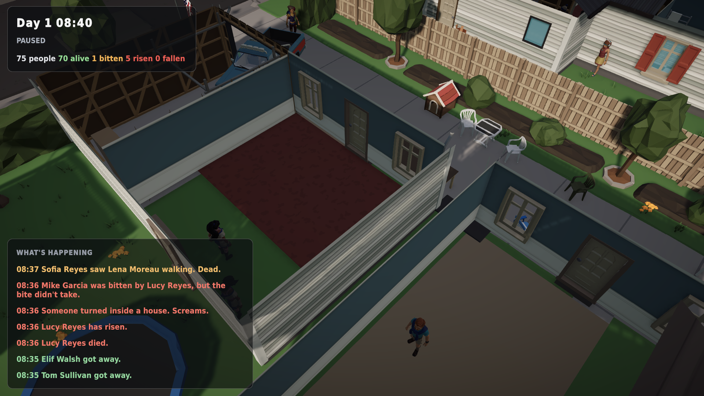

# A proper menu, and the people inside

*31 October 2026 (late night) · v0.7.0-alpha*

## Pause menu
The game finally has a menu, and it's built for the Deck's D-pad. Press **Start** (or **F10**, or **Esc** when nothing is selected):
- **Graphics:** switch Steam Deck / PC / Ultra live, without editing files.
- **Speed.**
- **New town:** a fresh seed means different people, different families and a different outbreak, with its own intro.
- **Controls:** every control at a glance.
- **Quit:** no more reaching for the Steam overlay.

## The people inside
Until now, anyone who went indoors simply vanished: sheltering was simulated, but invisible. Now they stand inside their actual rooms, and the roof cutaway reveals them. The frightened keep glancing around, and you can select them like anyone else.

> Cut the roof away and Grace and Felix are hiding inside. Out on the feed: *"Sofia Reyes saw Lena Moreau walking. Dead."* The flu wasn't the flu.

(Synty's preset houses are single meshes, so only the modular houses can be opened. Those are the ones with real interiors.)

## Still in the oven
Vehicles (with traffic that breaks down as the town panics), town decay, and a headless runner that plays dozens of town-days to measure the balance. All three are being built in parallel and land next.
