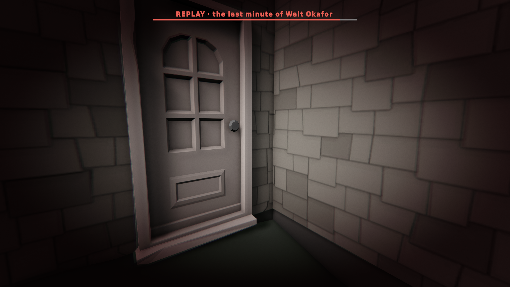
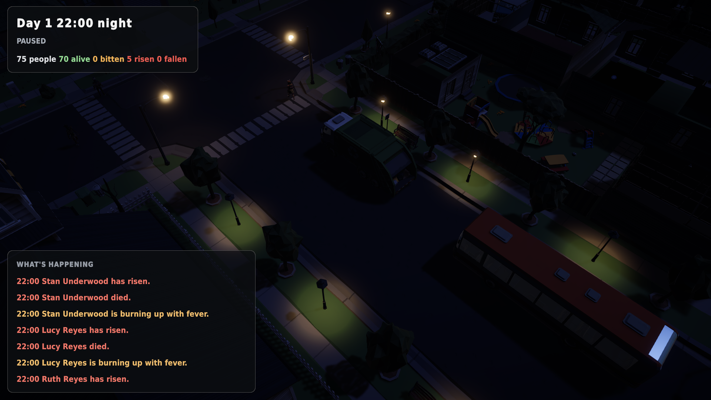
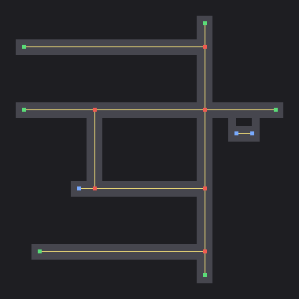

# Last moments, and the lights come on

*31 October 2026 (night) · v0.6.0-alpha*

## Rewind a life
The game now remembers the last minute of everything it showed you. When someone is bitten, dies or rises, select them and press **L3** (or **R**). The world rewinds, and you watch their final minute again through their own eyes, in slow motion. The image drains and narrows as the end approaches, and a quickening pulse tightens the edges.

> Walt Okafor's last minute ends at his own front door. Earlier that morning, his girlfriend Lena had told herself the fever was just the flu.

## Night has light now
The town's 44 street lamps switch on as dusk falls. Every lamp head glows, and a pool of real spotlights follows the camera to the nearest lamps, so night streets get warm pools of light without the cost of 44 dynamic lights. That's 4 live lights on the Deck and 14 on Ultra.

We also found that the Synty demo scene carries its own colour grade, which was stacking with ours and tinting every night dark red. Art scenes now hand their post-processing over to the game.

## Behind the scenes
- **A road network for the coming traffic,** extracted automatically from the town's road tiles: 680 m of road, 6 intersections, 6 ways out of town.

- **A headless simulation runner is being built:** it plays the whole town for days across many seeds, so the outbreak's balance can be measured rather than guessed.
- **Vehicles and town decay** are being built in parallel.
