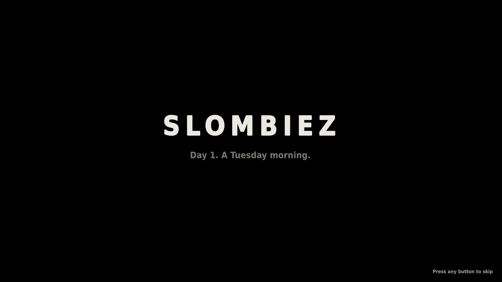
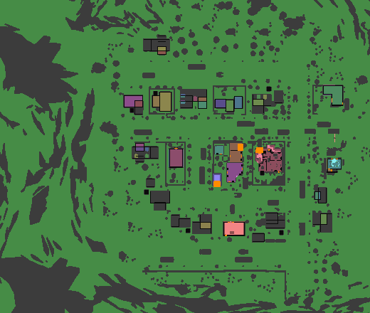
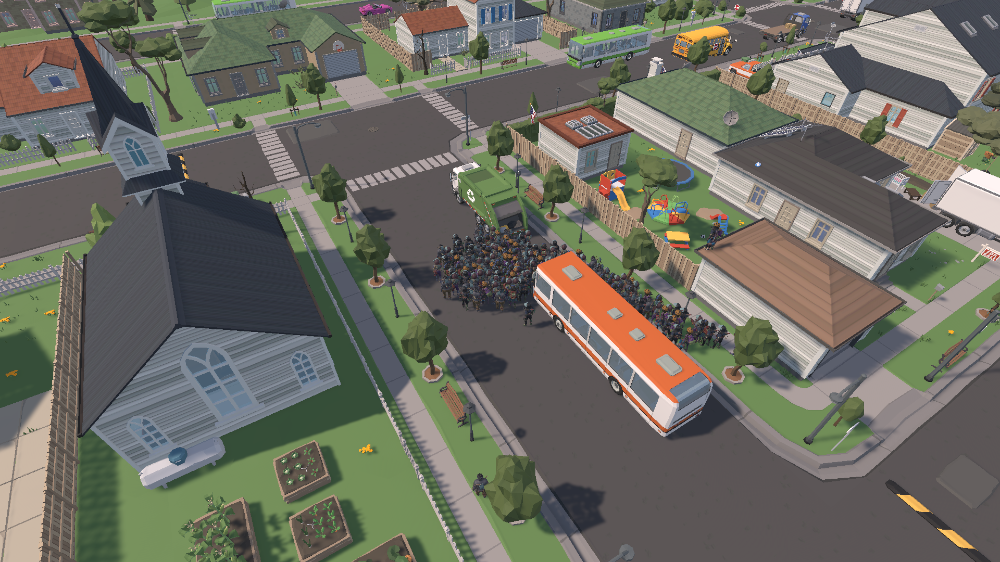
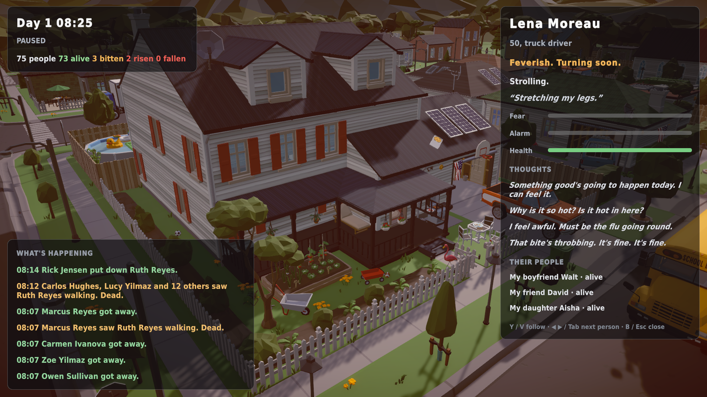
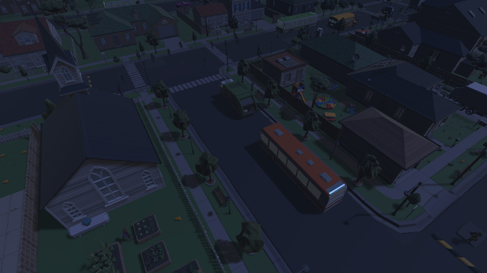
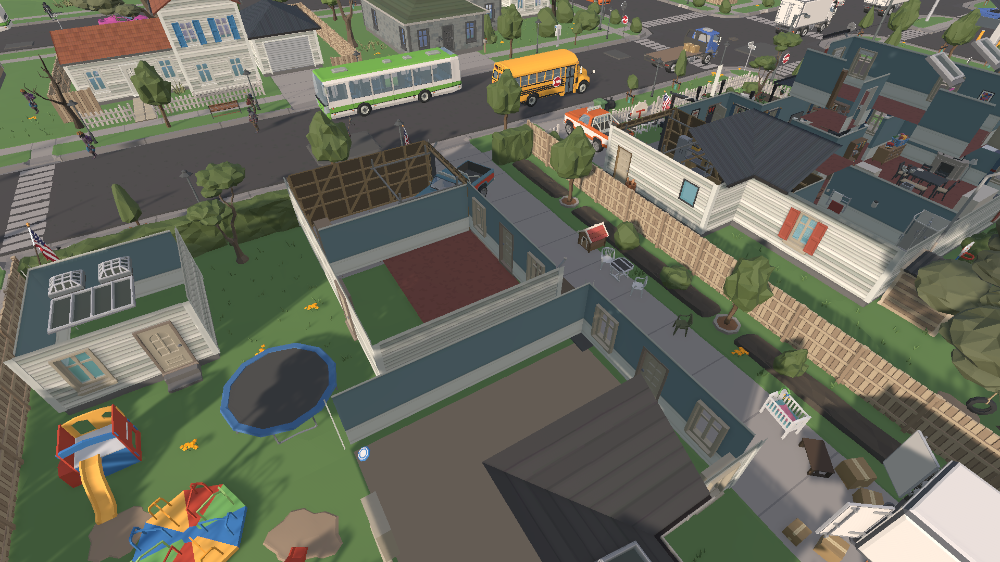
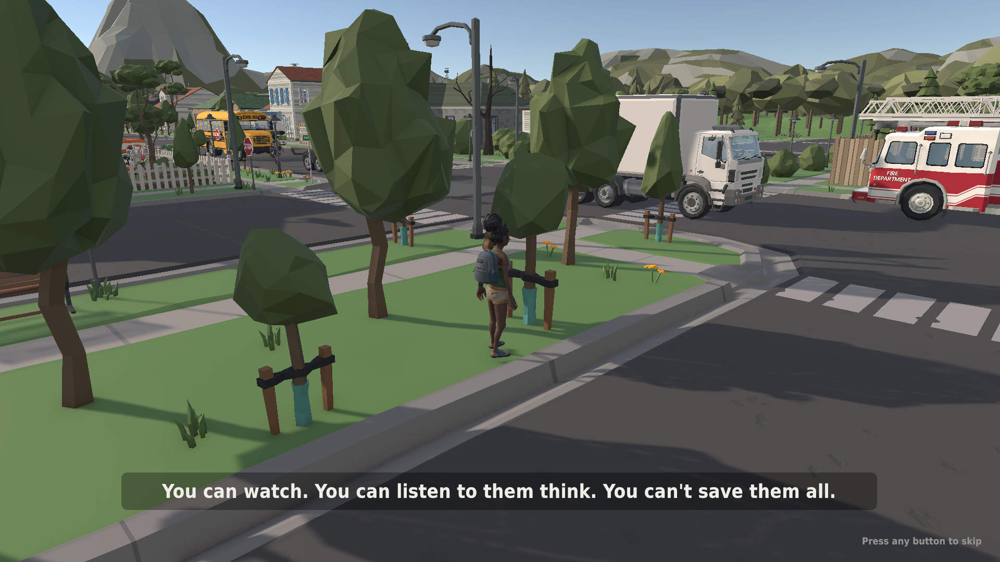

# Night one: from an empty project to a town that falls apart

*31 October 2026 · v0.1.0 → v0.4.0-alpha*

The project started tonight as an empty Unity template. By the end of the night the town is alive: 75 people go about their morning while the outbreak starts, quietly, with a fever someone mistakes for flu.

## A town with a real population
The town comes from Synty's POLYGON Town, but the game doesn't simply use it as scenery. A baking tool reads the scene and turns it into data the simulation can reason about: walkable ground (taken from Unity's NavMesh), walls, doors, windows, rooms and buildings, plus the height of the ground everywhere.

The population is then **derived from the buildings**: households sized by floor area, plus visitors. Every person gets a persona: name, age, job, family ties, personality (Big Five plus quirks like *loner*, *brave*, *paranoid*), ambitions, fears and defining life events.

Every zombie is one of them. The game never spawns extras.

## The dead remember who they were
Zombies don't just stand around. They meander, follow noise and scent, and drift back to **their own homes, their workplaces, and the people they loved**, then linger there. A zombie's temperament comes from the person it was: extraverts herd, loners walk alone. A horde only forms when there's a reason, such as a gunshot, prey, or someone they knew in life.

## Nobody knows at first
The outbreak starts with two people dead at dawn and three already bitten who don't know it. Hearing a bang only makes people *uneasy* ("Fireworks, maybe?"). The curious **walk over to have a look**, which is exactly how it spreads. Only seeing the dead causes panic: people warn others, flee, hide, fight back (the police shoot), or run to their loved ones.

Thoughts follow what each person knows. Before they've seen anything, they think about work, their families and the flu going round.

> **Lena Moreau**, 50, truck driver. *Feverish. Turning soon.* Strolling: "Stretching my legs."
> *"Why is it so hot? Is it hot in here?" · "I feel awful. Must be the flu going round." · "That bite's throbbing. It's fine. It's fine."*

## Watching
- **Inspector:** select anyone (mouse, or **A** on the Deck) to see who they are, what they're doing and why, their fear, alarm and health, their thoughts, and their people.
- **What's happening feed:** *"Carlos Hughes, Lucy Yilmaz and 12 others saw Ruth Reyes walking. Dead."* · *"Rick Jensen put down Ruth Reyes."*
- **Roof cutaway** to look inside houses, and a **day/night cycle** that matches what the simulation's eyes can see.

## The intro
The game opens with titles, then a fly-over of the waking town. The camera finds a **real patient zero** from the simulation, alive, with their actual name and job. Then the simulation takes its first step, and they rise.

## Performance: 9 fps → 229 fps
The first Deck-tier soak test ran at **9 fps**. Taking the renderer apart showed that the town itself cost almost nothing (218 fps without characters); the Sidekick characters were the whole problem. Each skinned mesh referenced **~2,400 bones for ~120 real transforms**, and recalculated its bounds every frame. Compacting the meshes at load (deduplicated, used bones only, fixed bounds) brought it to **97 fps**, and after pooling and prop optimisation it reached **150–229 fps** on the Deck tier on the dev PC.

## How it's checked
- 106 automated tests: determinism, path-following, crowd separation, horde motivation, the population invariant (*alive + dead + risen + destroyed = population*), and that nobody mentions zombies before they've seen one.
- Automated soak runs of every build at Deck resolution: frame-time percentiles, stuck zombies (0), path failures (0).

## Next
- **Vehicles that keep moving until it all falls apart:** commuters, the bus, the garbage truck. Then panic, crashes, car alarms that draw the dead, abandoned cars blocking roads, and people fleeing town.
- **A town that decays:** blood, debris, wrecks, broken windows and fires accumulate where things happened.
- **Voices:** generic ElevenLabs voices for reactions ("Was that a gunshot?", "They're inside!").
- Then the Spectacle pass: the director camera and through-their-eyes view.
