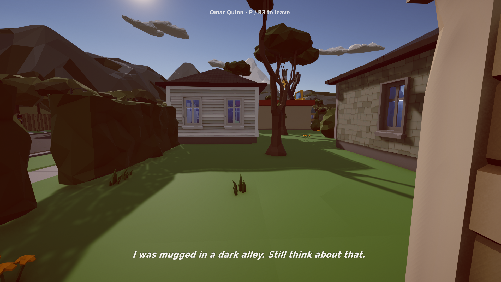
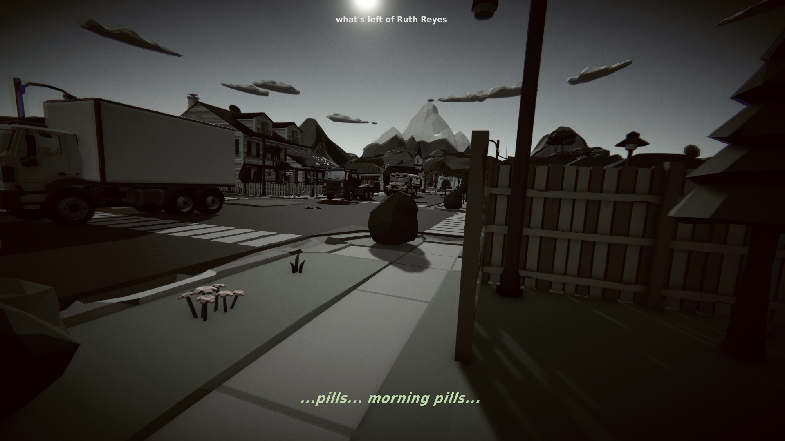
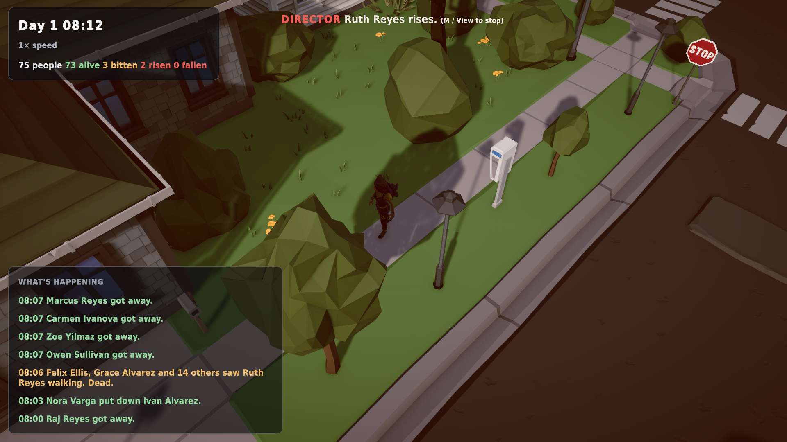

# Through their eyes, and a director that knows where to look

*31 October 2026 (late) · v0.5.0-alpha*

## See what they see
Select anyone and press **R3** (or **P**): the camera moves behind their eyes.

**The living** see through their fear. The vignette closes in as fear rises and pulses with a heartbeat, colour drains, the image shudders with chromatic aberration when they panic, and red creeps in at the edges when they're hurt. If they're running from something, their gaze keeps flicking back to it. Their latest thought fades in as a subtitle.

> Omar Quinn crosses a back lawn on a sunny morning. *"I was mugged in a dark alley. Still think about that."* He doesn't know yet.

**The dead** see a washed-out, sickly world through heavy grain. They hunt by sound, so **noises bloom as expanding rings** in their vision. What's left of the person surfaces in fragments.

> *What's left of Ruth Reyes*, a patient zero, shambles past the trucks. *"...pills... morning pills..."*

## The Director
Press **M** (or **View** on the Deck) and let the town tell its own story. The director watches every event and scores it: a bite, someone rising, a chase toward the living, a break-in, a first sighting, a fever, a police officer putting one down, and even a zombie *coming home*. It cuts to the most dramatic moment, holds the shot long enough to follow, and captions it. When things are quiet it drifts between ordinary lives.

## Also
- One-command releases: every update is packaged as **Steam Deck** and **PC Ultra** builds, and both are soak-tested from the packaged folder before publishing.

## Next
Vehicles that keep moving until the town falls apart, and a town that visibly decays: blood, debris, wrecks and fires accumulating where things happened. That work is being built in parallel right now.
