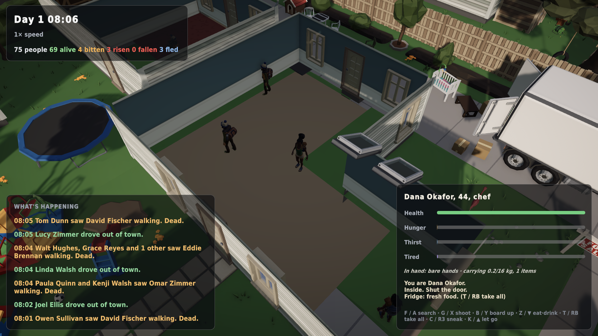
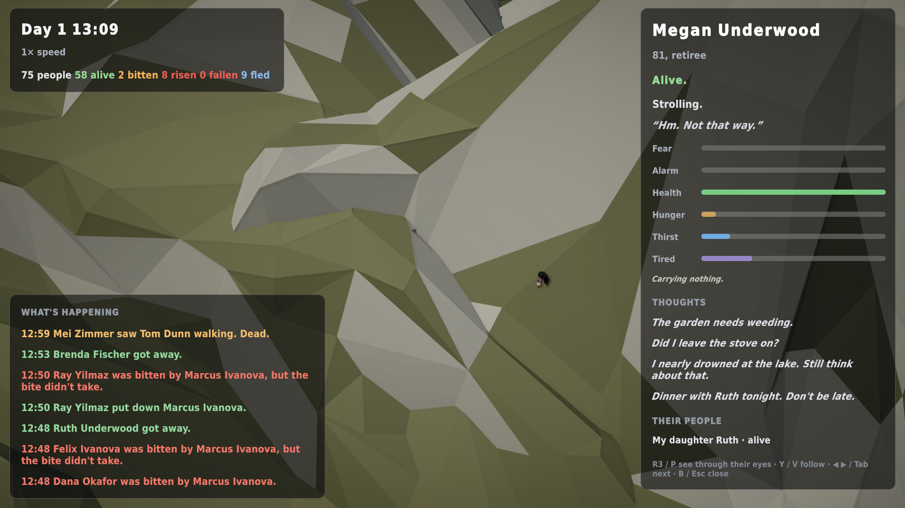

# Become anyone

*1 November 2026 · in progress toward v0.11*

Survival mode has started, and it isn't a separate game. It's the same town. Select anyone who's alive, press **K** (or **D-pad ▲** on the Deck), and you *are* them: their body, their home, their family, their hunger.

## What you can do
- **Move** with WASD or the stick, or click where to walk. **Run** with Shift or L3. **Sneak** with C or R3: slow and quiet, and the dead are slower to notice you.
- **One button acts (F / A):**
  - With a zombie in reach, you fight it.
  - Inside a building, you search the next cupboard, fridge or closet.
  - At a door, you go in; in a building with nothing left to search, you go out.
- **Shoot (G / X):** if they're carrying a gun. The police, veterans and security guards start with one. Every shot is heard across town.
- **Board up the doors (B / Y)** with planks, nails and a hammer. It's loud.
- **Eat or drink (Z / D-pad ▼):** whichever you need more.
- **Take everything (T / RB)** from what you just searched.
- **When they die, carry on as someone who loved them.** The game offers you their daughter, husband or best friend, then the nearest living person.

The HUD keeps a small first-person log of what's happening: *"Inside. Shut the door."* · *"Fridge: fresh food."* · *"The shot echoes down the street. They'll have heard that."*

## Everyone has a body now
The survival layer runs for the whole town, not just you:
- **Needs.** Everyone gets hungry (fully starving takes about 2.5 days) and thirsty (about 1.25 days), and they tire. The tap water stops after three days.
- **Loot.** Every building has loot that matches what it is: kitchens and closets in homes, shelves at the store, the pharmacy, the police station.
- **Scavenging and sharing.** Hungry people go scavenging, and decent people only raid the neighbours when they're desperate. Agreeable people share food with their household.
- **Barricades.** Aware people with a hammer and planks board up their doors. A fully boarded door holds the dead more than twice as long.

The inspector now shows hunger, thirst and tiredness, plus what each person is carrying:

## What the runner says about it (20 towns × 3 days, with survival on)
- All gate checks pass except one: in 2 of 20 towns the living put down **every** zombie that rose, so nobody beyond patient zero was lost. These towns hold; others fall.
- Variety score **95/100** (it was 88), with all five outcome types: fell, mostly fell, split, held, untouched.
- Fizzled outbreaks are down to 4 of 20.
- **Still failing:** in towns that fall, only 2–5% of survivors are out in daylight, so the streets are empty to watch. It's believable, but hunger takes 2.5 days to bite, so scavenging only starts late in a 3-day run.

## Found while playing (next fixes)
- **Families escape by car far too early.** Three drove out of town in the first five minutes of day one, before anyone could know what was happening.
- Weapons still don't change how *willing* the AI is to fight.
- You can't drive yet while playing someone.
