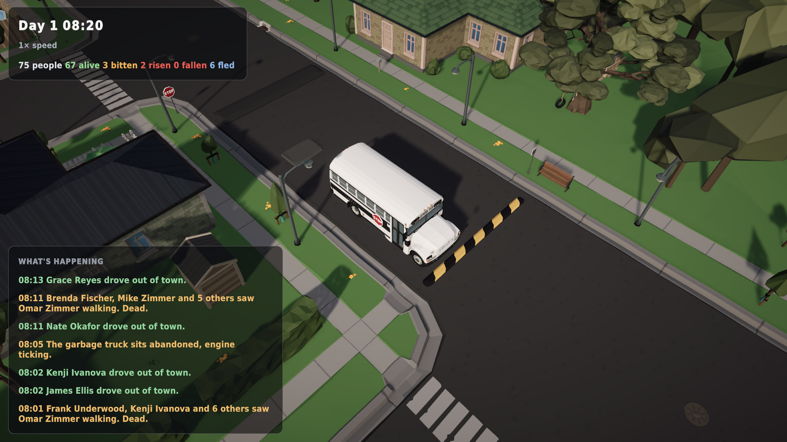
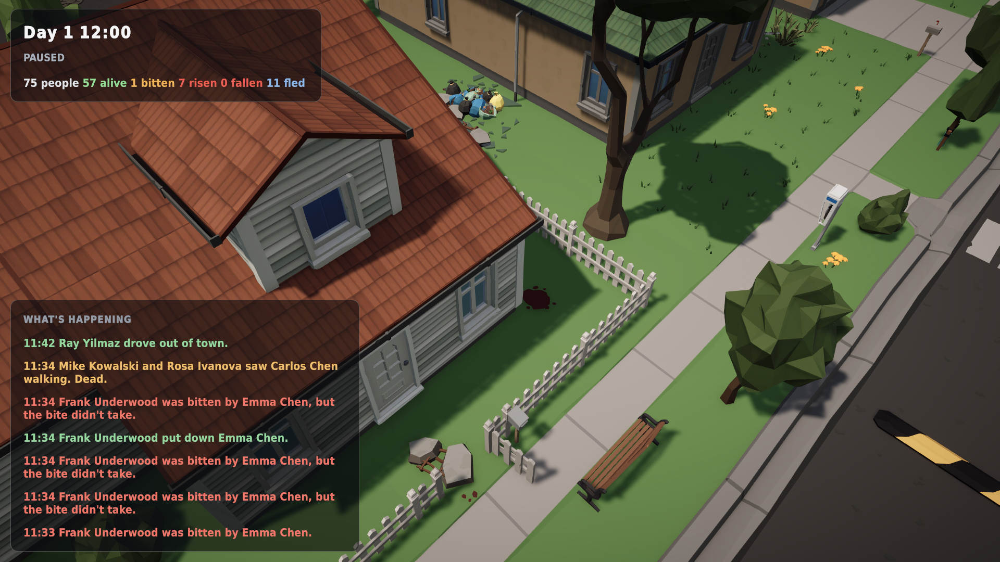

# Traffic until it falls apart, and a town that decays

*1 November 2026 (small hours) · v0.8.0-alpha*

## The town's own cars drive now
The 29 vehicles Synty placed in the town (cars, pickups, buses, school buses, delivery trucks and the garbage truck) are no longer scenery. They run on a road network extracted automatically from the road tiles: 680 m of road, two lanes per street, six intersections, six ways out of town.

On a calm morning, commuters drive to work, the bus loops through its stops and the garbage truck does its rounds. Then the outbreak arrives:
- Panic makes drivers speed and run junctions. Crashes set off car alarms, and the alarms draw the dead.
- The garbage truck is abandoned first, then *"The bus has stopped running. Its doors are open."*
- Cars abandoned in the road block it, and other drivers U-turn around them.
- Families make a run for their cars and drive out of town. The feed reports *"Grace Reyes drove out of town."* and the status bar counts who **fled**.

Everyone is still accounted for: alive + dead + risen + destroyed + fled = the whole town.

## The town decays
As things happen, the town records where: blood where people were bitten, glass and debris where cars crashed, smashed doors where the dead broke in, and litter that slowly spreads, fastest where people fled. Each mark becomes props from Synty's POLYGON Apocalypse pack. A marked spot gets denser as more happens there, and the clutter stays bounded so the Deck keeps up.

> By noon: a blood pool by the porch, rubble where the door was smashed, trash in the yard. *"Frank Underwood was bitten by Emma Chen (4 times)... Frank Underwood put down Emma Chen."*

## Next
A headless runner is playing the whole town for days across many seeds, to tune the outbreak so that some towns hold out, some fall, and the curve builds through day one rather than being instant or never happening. Early signs say too many people escape by car too quickly, so that's the first knob to turn.
