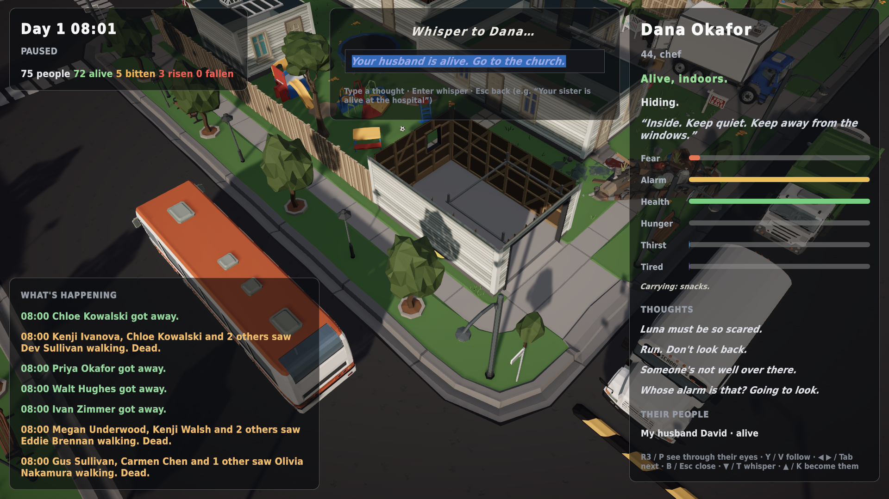

# v0.12: say it in your own words, and save the town

*1 November 2026 · v0.12.1-alpha*

## Whispers in your own words
The whisper menu now starts with **"Say it in your own words…"**. Type anything:

*"Your husband is alive. Go to the church."* Dana Okafor's husband is David. "Your husband" is understood as **him**, and "the church" becomes the nearest real church in this town. She gets a hopeful belief, a goal to find David there, and an urge to go.

It works **offline**. A thought parser turns what you type into the same small, closed set of effects the menu uses:
- **People** by name or by role: "your wife", "your sister". Names need whole words, so "Al" doesn't match "all".
- **Places** that exist in town.
- **Instructions:** go home, hide, run, leave town, eat, sleep, get some air.
- **Trust and doubt:** "don't trust Mike".
- **Grief:** "your wife is dead".
- **Hope, fear, guilt and loneliness.**

Anything it can't make sense of still lands as a passing thought, coloured by its tone. Nothing outside the effect schema can ever get through. A language model can replace the parser later for richer understanding, under the same rules.

## Save and load
**Start > Save** writes the whole town to disk:
- every person and their mind
- every zombie
- all 29 vehicles mid-drive
- every mark of decay
- the person you're playing

**Load** rebuilds the town from its seed and restores everything before the first tick. It's exact: tested saves continue bit-for-bit the same as if you'd never stopped, including cars driving out of town and wrecks on fire. A save is about 300 KB.

## The dead make sound, and a hitch I caused and fixed
v0.12.0 gave zombies synthesised groans, moans, snarls and door-pounding. The soak test caught a **100 ms hitch**, the first in several releases: all six groan voices were being synthesised the moment the first zombie moaned. v0.12.1 builds them while the town loads instead. **0 hitches** again.

| Tier | Average fps | p99 frame | Worst frame | Hitches |
|---|---|---|---|---|
| Steam Deck | 163 | 13.4 ms | 17 ms | 0 |
| Ultra 1080p | 82 | 21.6 ms | 27 ms | 0 |

## Tests
156 automated tests pass. New ones cover:
- whispers changing behaviour
- the free-text parser, including short names that need word boundaries
- exact save/load with traffic and decay

## Next
- Whispers to the **dead**: luring them with the places and people they remember.
- Giving survivors in a falling town reasons to come out of hiding.
