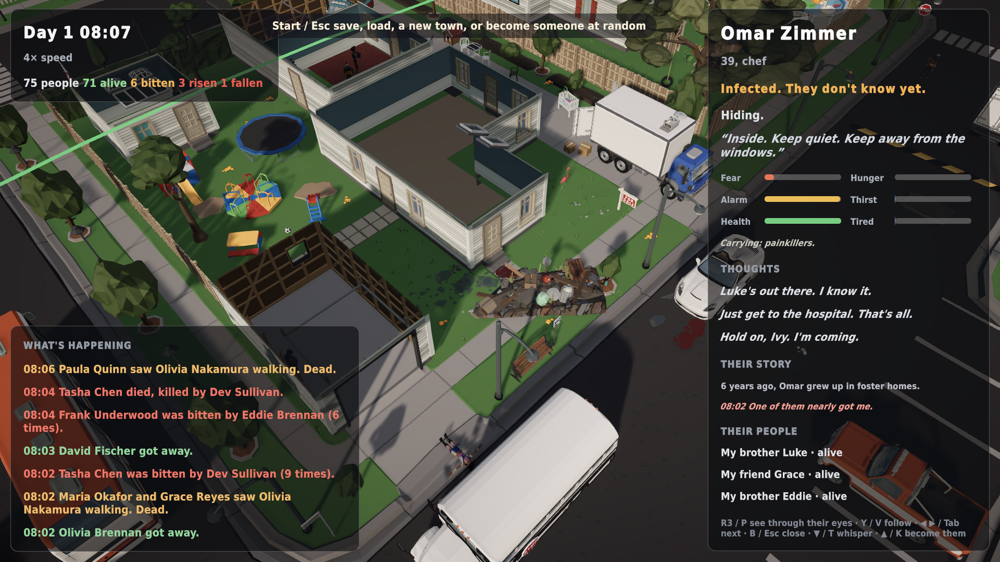
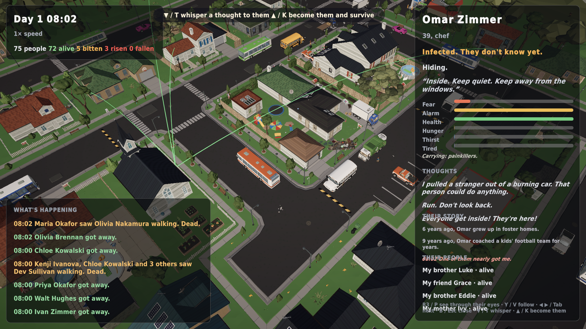

# v0.14: their story, their people

*1 November 2026 · v0.14.0-alpha*

## Their story
The inspector now has a **Their story** section. It holds one defining moment from before today (*"6 years ago, Omar grew up in foster homes."*) and today's moments with the time they happened (*"08:02 One of them nearly got me."*). Dark moments are tinted red. Omar is a chef. He's infected and doesn't know it yet; he's hiding, thinking *"Hold on, Ivy. I'm coming."*

While building it I found someone with the same memory twice. It wasn't a double count: they had fled from a zombie and then been grabbed by it in the same moment, and both events matter emotionally. They now read differently: *"One of them nearly got me"* versus *"One of them got its hands on me."*

## Their people, drawn in the world

Inspect anyone and soft arcs reach from them to the people they love, wherever they are in town: **green** if alive, **red** if risen, **grey** if they lie dead. You can see at a glance how far someone would have to go to reach their mother, and whether she's still there.

## Hints, and an inspector that fits
- **First-run hints:** one short line at a time after the intro. Each step goes away once you've done it, and the whole set never comes back.
- **The inspector got too tall** with needs, kit, thoughts, story and people. On a 720p screen its sections squashed into each other. Needs now sit in two columns, the lists are trimmed, and rows can no longer overlap.

## Performance
| Tier | Average fps | p99 frame | Hitches |
|---|---|---|---|
| Steam Deck | 167 | 12.7 ms | 0 |
| Ultra 1080p | 84 | 21.4 ms | 0 |

A 3-minute stress test at **16× speed** (8 game hours) on the Deck tier held 175 fps with zero hitches.
