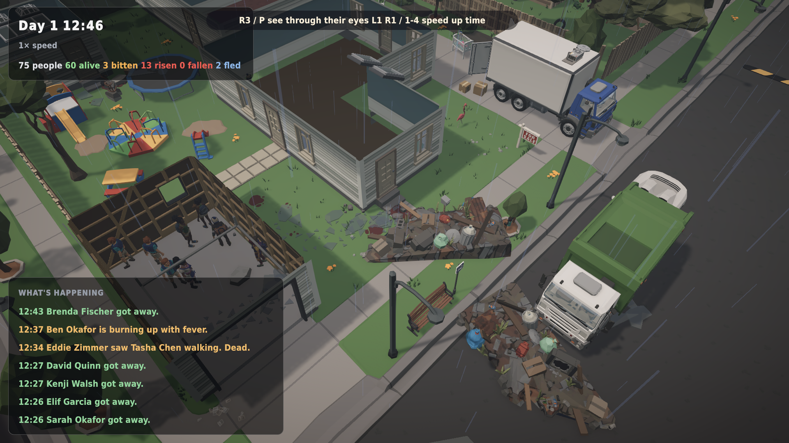

# v0.15: weather (and a bug the release gate caught)

*1 November 2026 · v0.15.0-alpha*

## Every town has its own weather
Weather comes in three-hour spells: misty mornings, foggy dusks, grey skies and rain, and a spell tends to linger. It's a pure function of the town's seed and the time, so it costs nothing to save and replays identically.

**It matters to the simulation:**
- Mist, rain and fog shorten how far anyone can see outdoors, the living and the dead alike. Fog halves sight.
- Rain drowns sound: footsteps, shouts and breaking glass carry about a quarter less far.

**You see and hear it:** grey light, softer shadows, fog in the streets, rain falling around wherever you look, rain on roofs and cars, and the birds going quiet. The feed tells you when it turns: *"Fog rolls in. You can barely see across the street."*

**Balance (20 towns × 3 days):**
- All Phase 2 gate checks pass, with **zero** outbreak fizzles.
- Survivors at day 3 rose from 27% to 35%. The weather gives the living cover, and 6 of 20 towns now hold.

## What failed
The first v0.15 release attempt was **refused by the release pipeline**. The Steam Deck soak test logged two exceptions, and the script won't publish a build that throws.

The cause was a feed-merging bug. When several people see the same walking corpse, the feed merges them into one line (*"Kenji, Chloe and 2 others saw Dev walking. Dead."*). But a line about a *bite* by that same corpse also remembers the corpse, with no list of witnesses. A sighting right after a bite tried to add itself to the bite line and crashed. Worse, the crash happened **inside the simulation step**, because the feed listens to simulation events. The new "patient zeros rise at home" opening made that bite-then-sighting sequence common.

The fix:
- Sightings only merge into sighting lines.
- The feed can no longer break a simulation tick: any future mistake there is logged as an error, which the release gate still catches.

## Performance
| Tier | Average fps | p99 frame | Hitches | Exceptions |
|---|---|---|---|---|
| Steam Deck | 159 | 13.7 ms | 0 | 0 |
| Ultra 1080p | 81 | 22.2 ms | 0 | 0 |

160 automated tests pass (3 new for weather).
