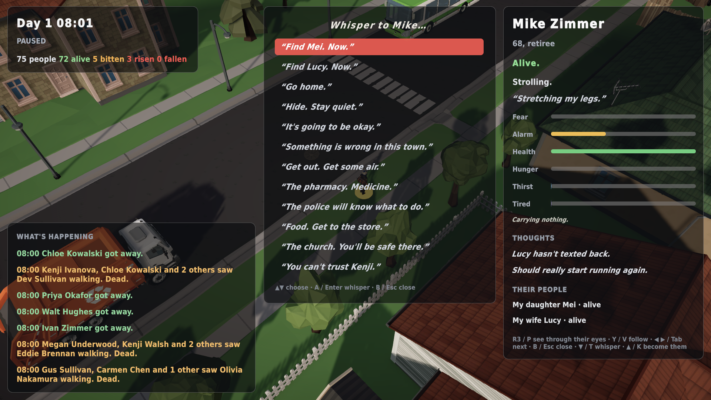
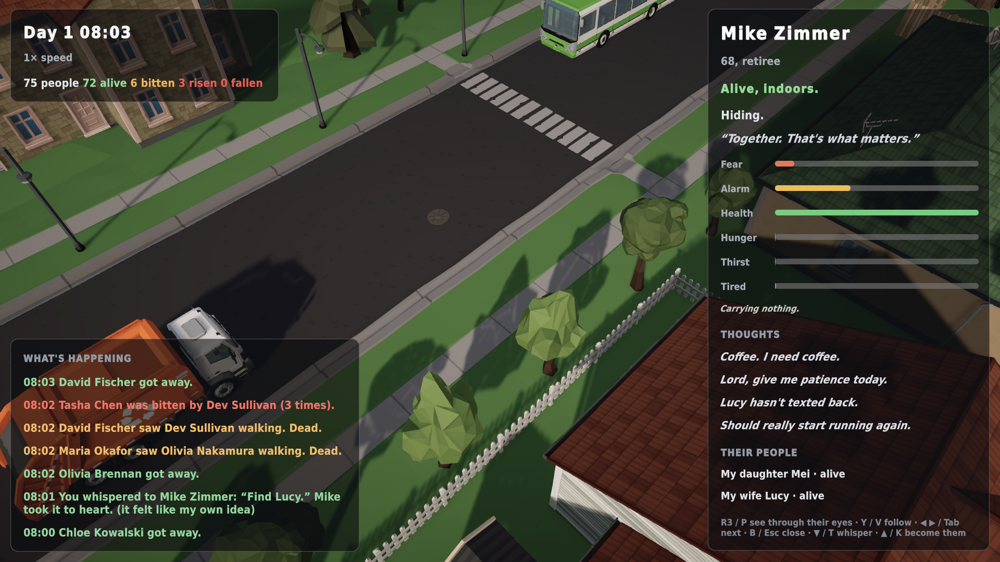

# Whispers

*1 November 2026 · in progress toward v0.12*

You can now put thoughts into people's heads.

Select anyone and press **D-pad ▼** (or **T**). Time holds still and you get a short list of thoughts that fit *this* person:

Mike Zimmer is 68 and retired. He's out for a walk thinking *"Lucy hasn't texted back."* Lucy is his wife. So the menu offers:
- **His own people:** "Find Mei. Now." (his daughter) and "Find Lucy. Now." (his wife).
- **Instincts:** "Go home.", "Hide. Stay quiet.", "It's going to be okay.", "Something is wrong in this town.", "Get some air."
- **Places that really exist in this town**, the nearest of each: the pharmacy, the police station, the store, the church.
- **Doubt:** "You can't trust Kenji." (someone he knows, never family).

## They react as themselves
A whisper isn't a command. Each person's personality decides what happens:
- It takes hold (*"it felt like my own idea"*).
- They shrug it off.
- It feels foreign and puts them on edge (paranoid minds).
- A fragile mind seizes on it and spirals.

The inspector and the feed tell you which:

*"You whispered to Mike Zimmer: 'Find Lucy.' Mike took it to heart."* Two minutes later he's indoors with her: *"Together. That's what matters."*

## Thoughts that change what people do
This was a gap until now. The mind model already accepted whispers (beliefs, fears, goals, urges), but **behaviour never read them back**: a whisper changed what someone *thought*, not what they *did*. Now an accepted urge or a planted goal becomes a strong choice in their day. It still competes with everything else they want, it fades as the urge fades, and danger always comes first. They act on it immediately.

Tested automatically:
- A strong "go home" whisper sent **6 of 6** people home within 45 minutes. An unwhispered control group: 0 of 6.
- A planted "find them" goal brought **4 of 4** people to the person they were told to find.

## Also new
- **The dead make sound.** There are no generated voice files yet, so zombies were silent. Now they have synthesised groans: six voices, built from a sagging glottal buzz through drifting vowel formants, with breath and a wet rasp. There are also distant moans echoing down the street, snarls when they lunge, and fists on doors during sieges.
- **Pause menu: "Become someone"** drops you into a random life (survival). Choose it again to let go.
- **Save/load** for the whole town (including traffic) is being built and tested in the background.

## Not done yet
- Whispering to the **dead** (luring them toward places they remember) isn't wired up yet. For now the menu just says they're gone.
- **Free-text whispers** need a language model to turn your words into the safe, structured effects above. That's next on the list.
